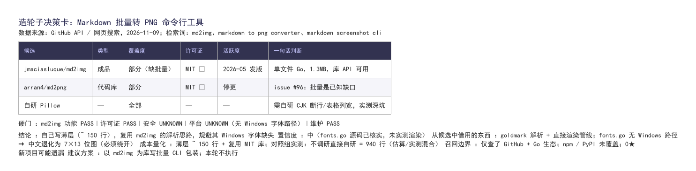

# 决策卡画廊

真实调研产出的决策卡，每张用**卡里推荐的工具**渲染成图——本画廊首张即由
[md2img](https://github.com/jmaciasluque/md2img)（MIT）生成。

## 001 · Markdown 批量转 PNG（2026-11-09）



三平台实测使用的原始需求。要点：Windows 字体路径缺失在源码级被两个平台独立复现；
「不要调研」对照组写出 940 行自研渲染，本卡的薄层方案约 150 行。

## 渲染踩坑记录（Windows）

md2img 的字体按「正文 / 标题 / 表头 / 代码」四路独立加载，`-font-file` 只覆盖正文。
Windows 下必须四个参数全部指定，否则标题与表头退化为占位符：

```bash
md2img -font-file C:/Windows/Fonts/simhei.ttf \
       -heading-font-file C:/Windows/Fonts/simhei.ttf \
       -table-header-font-file C:/Windows/Fonts/simhei.ttf \
       -code-font-file C:/Windows/Fonts/simhei.ttf \
       -trim -o card.png card.md
```

## 提交你的卡

欢迎 PR：一张卡 = 一个 `NNN-短名.md` + 渲染好的 PNG + 三行背景说明
（需求、结论、最有价值的发现）。只收真实调研产出，不收示例。
